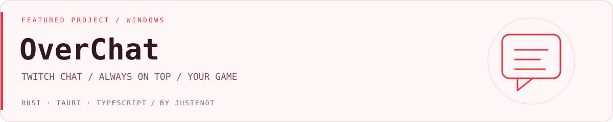

<picture>
  <source media="(prefers-color-scheme: dark)" srcset="assets/cover-dark.svg">
  
</picture>

# OverChat

Моё приложение для стримеров: чат Twitch поверх игры или любого другого окна Windows. Расположите чат там, где удобно читать сообщения, настройте прозрачность и включите сквозные клики, чтобы продолжать играть.

**Версия 0.5.1** · Windows · Автор — [JustEn0t](https://github.com/JustEn0t)

## Возможности

- **Чат без входа.** Введите ник канала или ссылку Twitch — можно читать любой публичный чат.
- **Поверх игры.** Прозрачное окно без рамки, перемещение и изменение размера, режим для безрамочных игр.
- **Сквозные клики.** Мышь управляет игрой даже в области чата.
- **Горячие клавиши.** Быстро скрывайте чат или возвращайте управление окном; сочетания можно менять.
- **Смайлики и значки.** Twitch и 7TV, анимации и наложенные смайлики; картинки значков доступны после необязательного входа.
- **Ваш внешний вид.** Шрифт, размер, прозрачность фона и сообщений, компактный режим и автоскрытие старых сообщений.
- **Работа в фоне.** Трей, автозапуск с Windows, сохранение настроек и положения окон, переподключение к чату.
- **Удобное чтение.** Фильтр команд, пауза автопрокрутки при чтении истории и удаление сообщений вслед за модерацией Twitch.

## Как пользоваться

1. Запустите приложение, введите ник или ссылку канала и нажмите **Подключить**.
2. Перетащите окно чата за верхнюю полоску и подберите размер за угол справа внизу.
3. Нажмите **Ctrl+Shift+X**, чтобы включить сквозные клики.
4. Нажмите **Ctrl+Shift+H**, чтобы скрыть или вернуть чат.
5. Настройте шрифт и прозрачность под свою игру.

Оверлей предназначен для **оконного и безрамочного оконного режима**. В эксклюзивном полноэкранном режиме Windows может не отображать чат поверх игры.

## Технологии

Rust · Tauri 2 · TypeScript · Vite · WebView2

Чат подключается через Twitch IRC по WebSocket. Смайлики загружаются из Twitch и 7TV. Необязательный вход использует OAuth Device Code Flow, токены хранятся в диспетчере учётных данных Windows.

## Запуск из исходников

Нужны Windows, Node.js 20+, Rust с инструментами MSVC и WebView2.

```powershell
npm ci
npm run app:dev
```

Сборка приложения и установщика:

```powershell
npm run app:build
```

Результат: `src-tauri/target/release/overchat.exe`, установщик — в `src-tauri/target/release/bundle/nsis/`.

## Проверки

```powershell
npm run build
cargo test --offline --manifest-path src-tauri/Cargo.toml
```

Сетевые тесты Twitch и 7TV запускаются отдельно: `cargo test --manifest-path src-tauri/Cargo.toml -- --ignored`.

[Архитектура, подробные настройки и проверка в играх →](docs/development.md)

## О проекте

Разрабатываю OverChat, чтобы читать чат во время игры без переключения окон.

Автор — **[Арсений / JustEn0t](https://github.com/JustEn0t)**.

Независимый проект, не связан с Twitch или 7TV. Названия и материалы соответствующих сервисов принадлежат их владельцам.
